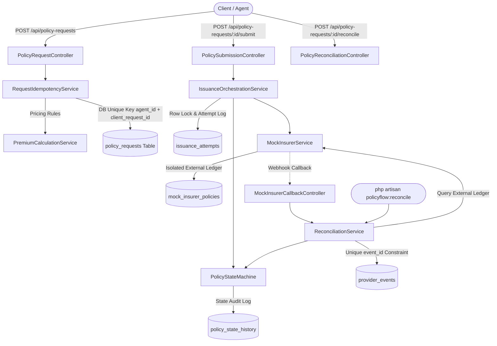

# PolicyFlow — Technical Interview & Architecture Guide

## 1. Project Overview
**PolicyFlow** is an enterprise-grade, fault-tolerant travel insurance issuance and reconciliation engine engineered in Laravel 11 and PHP 8.3. The system coordinates policy request intake, precise financial premium calculation, state machine governance, remote insurer communication simulation, asynchronous callback handling, and automated reconciliation.

The core challenge PolicyFlow solves is the **distributed systems fallacies in financial transactions**: network partitions, client retries, delayed callbacks, and remote timeouts. It guarantees that no customer is double-charged or issued duplicate policies under intermittent network failures, repeated webhook deliveries, or client race conditions.

---

## 2. Architectural Blueprint

### Layer Separation:
- **Transport / API Controllers**: Parse HTTP requests, validate input through Form Requests, and delegate to services.
- **Form Requests**: Strict schema validation, boundary validation, custom date-relationship and customer age rules.
- **Domain Services**:
  - `PremiumCalculationService`: Pure calculation with `bcmath` decimal-safe precision.
  - `RequestIdempotencyService`: Deduplication of incoming intake requests with DB transaction and catch of unique violations.
  - `PolicyStateMachine`: Strict whitelist of transitions; enforces terminal immutable state for `ISSUED`.
  - `IssuanceOrchestrationService`: Orchestrates attempt logging, concurrency control, remote dispatch, and failure handling.
  - `MockInsurerService`: Deterministic local insurer with isolated persistent storage (`mock_insurer_policies`).
  - `ReconciliationService`: Webhook idempotent absorption and status query reconciliation.
- **Database / Eloquent**: Normalized relational tables, foreign key constraints, composite unique indexes, transactional isolation.

---

## 3. End-to-End Request Lifecycle

1. **Intake (`POST /api/policy-requests`)**:
   - Form request validates schema, date logic, coverage limits, customer age.
   - Idempotency service looks up `(agent_id, client_request_id)`.
   - If existing, returns HTTP 200 with the original logical request and `is_retry: true`.
   - If new, `PremiumCalculationService` computes the rate, writes the immutable snapshot to `policy_requests` with status `VALIDATED`, records `RECEIVED -> VALIDATED` in `policy_state_history`, and returns HTTP 201.
2. **Submission (`POST /api/policy-requests/{id}/submit`)**:
   - Acquires pessimistic row lock (`lockForUpdate()`).
   - Verifies eligible starting status (`VALIDATED` or `FAILED` for retries).
   - Increments `attempt_number`, generates unique `idempotency_key`, transitions to `SUBMITTED`, writes `issuance_attempts` record (`STARTED`).
   - Dispatches remote request to insurer.
3. **Execution Scenarios**:
   - **`SUCCESS`**: Insurer writes policy to its own ledger; returns policy number; engine transitions to `ISSUED` and assigns `policy_number`.
   - **`TEMPORARY_FAILURE`**: Upstream returns 503; engine records failure in attempt, transitions to `FAILED` (eligible for retry).
   - **`TIMEOUT_AFTER_ISSUE`**: Insurer creates policy in external ledger, but connection drops. Client gets `ProviderTimeoutException`. Engine transitions request to `NEEDS_RECONCILIATION`.
   - **`DELAYED_CALLBACK`**: Insurer returns pending; engine transitions to `PENDING_CONFIRMATION`.
4. **Reconciliation & Callbacks**:
   - **Callback (`POST /api/mock-insurer/callback`)**: Inserts unique `event_id` in `provider_events`. If duplicate, immediately returns `DUPLICATE_IGNORED`. Transitions `PENDING_CONFIRMATION -> ISSUED`. Never downgrades an `ISSUED` policy.
   - **Reconciliation (`POST /api/policy-requests/{id}/reconcile` or CLI)**: Queries mock insurer's ledger by `provider_reference`, finds existing policy number, and completes transition to `ISSUED` without creating a second policy.

---

## 4. Premium Calculation Mechanics & Verification

### Exact Formula
$$\text{Premium} = \text{Base Daily Rate} \times \text{Travel Days} \times \text{Age Multiplier} \times \text{Destination Multiplier} \times \text{Coverage Multiplier}$$

- **Base Daily Rate**:
  - `BASIC`: ₹12.00
  - `PLUS`: ₹20.00
  - `PREMIUM`: ₹30.00
- **Travel Days**:
  - Inclusive calendar day count: $\text{diffInDays} + 1$ (minimum 1 day).
- **Age Multiplier (at `trip_start`)**:
  - $0 \le \text{age} \le 17$: $1.10$
  - $18 \le \text{age} \le 60$: $1.00$
  - $61 \le \text{age} \le 70$: $1.50$
  - $\text{age} \ge 71$: $2.00$
- **Destination Multiplier**:
  - `DOMESTIC`: $1.00$
  - `INTERNATIONAL`: $1.80$
- **Coverage Multiplier**:
  - ₹100,000: $1.00$
  - ₹300,000: $1.25$
  - ₹500,000: $1.50$

### Mandatory Test Proof:
- `plan_code`: `PLUS` (₹20.00)
- `trip_start`: `2026-11-10`, `trip_end`: `2026-11-14` $\rightarrow 4 + 1 = 5$ days
- `date_of_birth`: `1998-04-10` $\rightarrow$ Age on 2026-11-10 is 28 years $\rightarrow$ Multiplier: $1.00$
- `destination`: `INTERNATIONAL` $\rightarrow$ Multiplier: $1.80$
- `sum_insured`: ₹300,000 $\rightarrow$ Multiplier: $1.25$
$$\text{Premium} = 20.00 \times 5 \times 1.00 \times 1.80 \times 1.25 = 100 \times 1.80 \times 1.25 = 180 \times 1.25 = \mathbf{₹225.00}$$

---

## 5. Reliability, Idempotency, and Concurrency Controls

### Application-Level Idempotency vs Database-Enforced Uniqueness
- **Application-Level Idempotency**: Checking `PolicyRequest::where('agent_id', $agentId)->where('client_request_id', $clientRequestId)->first()` in application memory before saving.
  - *Vulnerability*: Under high concurrent traffic (e.g. 50 parallel requests from a distributed queue), two processes can check the DB simultaneously, both see no existing record, and both attempt to create it.
- **Database-Enforced Uniqueness**: A `UNIQUE KEY uniq_agent_client_req (agent_id, client_request_id)` at the database storage engine layer.
  - *Advantage*: The database engine serializes index page updates. Exactly one process wins; the other receives an integrity violation (SQLSTATE 23000).
- **PolicyFlow's Combined Defense**: PolicyFlow uses fast-path application lookup, wraps inserts in a transaction with row-level locks, and wraps execution in a `try...catch (QueryException $e)` block that gracefully catches duplicate key collisions and returns the winner's record as HTTP 200 rather than crashing with an HTTP 500 error.

### Why a Remote Timeout Does NOT Mean Failure
In distributed computing, an HTTP timeout only means the **caller stopped waiting for a response**. It gives zero information about what happened on the remote server:
1. The request might have failed before reaching the server.
2. The server might have received the request, processed the financial issuance, and committed the policy to its ledger, but the response packet was dropped by an intermediate router.
3. The server might still be executing the request.
If an application marks the transaction as `FAILED` and allows the agent to re-submit with a fresh request, the customer will be issued **two policies** and charged twice.
PolicyFlow's solution: On timeout, status moves to `NEEDS_RECONCILIATION`. The system queries the insurer's query API / ledger. If the policy exists, it adopts the existing policy number.

---

## 6. Comprehensive 20 Interview Questions & Answers

### Q1: What is the difference between at-least-once and exactly-once processing in insurance issuance?
**Answer:** Network transports (HTTP, messaging queues) can only guarantee *at-least-once* delivery because network timeouts necessitate retries. *Exactly-once* semantics cannot exist at the raw transport layer. In PolicyFlow, we achieve end-to-end exactly-once business semantics by designing consumers (intake and callback webhooks) to be strictly idempotent using unique keys (`agent_id + client_request_id` and `event_id`).

### Q2: Why did you use `bcmul` instead of standard PHP floating-point multiplication (`*`) for pricing?
**Answer:** Standard IEEE 754 floating-point representations have rounding imprecisions (e.g., `0.1 + 0.2 !== 0.3`). In financial systems calculating thousands of policies, floating point drift causes discrepancies in paise/cents. `bcmul()` executes arbitrary-precision decimal mathematics on string representations, ensuring exact decimal representation without truncation drift.

### Q3: Why is `policy_requests` populated with an immutable calculation snapshot?
**Answer:** Pricing rules, tax percentages, and multipliers change over time. If an intake request is retried or audited three weeks later, recalculating the rate using current date or altered configuration would alter the agreed premium. The immutable snapshot preserves the exact inputs (`age_multiplier`, `travel_days`, `base_daily_rate`) and formula at the second of validation.

### Q4: How does PolicyFlow prevent race conditions when two identical requests hit the server concurrently?
**Answer:** At the database level, a composite unique index exists on `(agent_id, client_request_id)`. Within the service, we begin a database transaction, check with `lockForUpdate()`, and catch `\Illuminate\Database\QueryException` with SQLSTATE `23000`. If a concurrent thread inserts between lookup and insert, the second thread catches the error, fetches the inserted record, and returns HTTP 200 with `is_retry: true`.

### Q5: Can an `ISSUED` policy ever transition back to `SUBMITTED` or `FAILED`?
**Answer:** No. In `PolicyStateMachine`, `ISSUED` is a terminal state. The transition map has an empty array for `PolicyStatus::ISSUED`. Furthermore, the callback handler specifically guards against stale or out-of-order rejection webhooks: if the policy is already `ISSUED`, any conflicting webhook is logged and flagged as `IGNORED_ALREADY_ISSUED`.

### Q6: Why does `IssuanceOrchestrationService` record an `IssuanceAttempt` record before making the external HTTP call?
**Answer:** If the PHP worker crashes, the machine reboots, or the network hardware fails while making the remote call, having an attempt logged in the database with status `STARTED` ensures the audit trail reflects that an in-flight attempt was initiated. This prevents silent failures.

### Q7: Why shouldn't a database transaction wrap the remote HTTP call to the insurer?
**Answer:** Holding an open database transaction while making a remote network call holds database connection pool slots and row locks for the duration of network latency (potentially 10–30 seconds). Under moderate traffic, this exhausts connection pools and leads to cascading timeouts across the entire platform. The correct pattern is: commit local state to `SUBMITTED`, release DB lock, perform network call, and open a new short transaction to record the outcome.

### Q8: How is the mock insurer implemented to ensure realistic timeout recovery?
**Answer:** Rather than hardcoding responses or using memory-only mocks, `MockInsurerService` writes directly to a separate table `mock_insurer_policies`. In scenario `TIMEOUT_AFTER_ISSUE`, the insurer writes the confirmed policy to `mock_insurer_policies` and then throws `ProviderTimeoutException`. When `ReconciliationService` queries `checkStatus()`, it queries `mock_insurer_policies` and finds the real persistent record.

### Q9: What happens if an insurer sends duplicate webhook callbacks for the same policy?
**Answer:** The `provider_events` table enforces a unique constraint on `event_id`. When the first callback arrives, it is processed and recorded. When the identical event arrives a second time, `ReconciliationService` detects the existing event and immediately returns HTTP 200 with `DUPLICATE_IGNORED`, preventing redundant database mutations or duplicate notifications.

### Q10: What is the role of `NEEDS_RECONCILIATION` state?
**Answer:** It decouples indeterminate outcomes from immediate failure. It flags the request for reconciliation workers or automated cron commands (`policyflow:reconcile`), preventing customer support from mistakenly advising a customer that their policy failed when it may have been issued by the underwriter.

### Q11: How does PolicyFlow calculate age on `trip_start` rather than current date?
**Answer:** `PremiumCalculationService` takes `date_of_birth` and `trip_start`, parsing both via Carbon to midnight start of day, and computes `$birthDate->diffInYears($startDate)`. This ensures that if a customer turns 18 or 61 between the booking date and their actual departure date, they are priced according to their risk category on the day the policy coverage begins.

### Q12: How are inclusive travel days calculated?
**Answer:** Travel insurance covers both the day of departure and the day of return. The formula is `$startDate->diffInDays($endDate) + 1`. A trip from Nov 10 to Nov 14 gives `4 + 1 = 5` days. A same-day trip (Nov 10 to Nov 10) gives `0 + 1 = 1` day.

### Q13: How does the application handle SQL injection or mass-assignment vulnerabilities?
**Answer:** Mass assignment is prevented by defining strict `$fillable` arrays on all Eloquent models. SQL injection is mitigated by using PDO prepared statements through Laravel Eloquent and query builder parameter binding.

### Q14: What is the benefit of backing enums in PHP 8.2+ for domain models?
**Answer:** Backed enums (`PlanCode: string`, `Destination: string`, `PolicyStatus: string`) provide compile-time type safety, eliminate magic strings, provide IDE autocompletion, and allow encapsulation of domain rules (e.g. `PlanCode::baseDailyRate()`, `Destination::multiplier()`) directly inside the enum.

### Q15: How does PolicyFlow handle database migrations rollback?
**Answer:** All migrations define reciprocal `down()` methods dropping foreign keys and tables in exact reverse topological order (`mock_insurer_logs`, `mock_insurer_policies`, `policy_state_history`, `provider_events`, `issuance_attempts`, `policy_requests`), enabling clean rollbacks via `php artisan migrate:rollback`.

### Q16: What happens if a callback is received for a policy that does not exist in the database?
**Answer:** The callback handler logs the event in `provider_events` with `processing_status = 'ORPHAN_UNMATCHED'`, records the payload for security audit, and returns HTTP 200 with `status: 'UNMATCHED'`, preventing webhook retry storms from the provider while maintaining an audit log.

### Q17: How would you scale PolicyFlow to handle 10,000 requests per minute?
**Answer:**
1. Put the intake endpoint behind a load balancer and publish validated requests to an event bus (e.g. Kafka or AWS SQS).
2. Process issuance asynchronously via worker pools with rate-limiting to protect insurer throughput.
3. Use Redis for fast distributed lock leases (`Redlock`) to throttle concurrent submissions per customer.
4. Read-replicas for query endpoints (`GET /api/policy-requests`).

### Q18: Why did you create an Artisan CLI command for reconciliation?
**Answer:** Long-running reconciliation should not be dependent on incoming HTTP requests. An Artisan command (`php artisan policyflow:reconcile`) can be scheduled via Laravel Task Scheduling (`schedule:run`) in a crontab to sweep pending requests automatically every 5 minutes.

### Q19: What HTTP status codes are returned and why?
**Answer:**
- `201 Created`: Fresh policy request created.
- `200 OK`: Successful retrieval, idempotent replay of existing intake, synchronous policy issuance, or callback acknowledgment.
- `202 Accepted`: Asynchronous acceptance (`PENDING_CONFIRMATION` or `NEEDS_RECONCILIATION`).
- `404 Not Found`: Resource does not exist.
- `422 Unprocessable Entity`: Validation failure or invalid state machine transition attempt.
- `502 / 504`: Upstream provider failure or timeout.

### Q20: What are the main design trade-offs made in this implementation?
**Answer:** We prioritized **data integrity and auditability** over raw write throughput. By writing to `policy_state_history`, `issuance_attempts`, and capturing complete JSON snapshots, we use slightly more disk storage and write operations per request. However, in financial insurance issuance, having an undeniable, replayable audit trail is non-negotiable for compliance, dispute resolution, and reconciliation.
